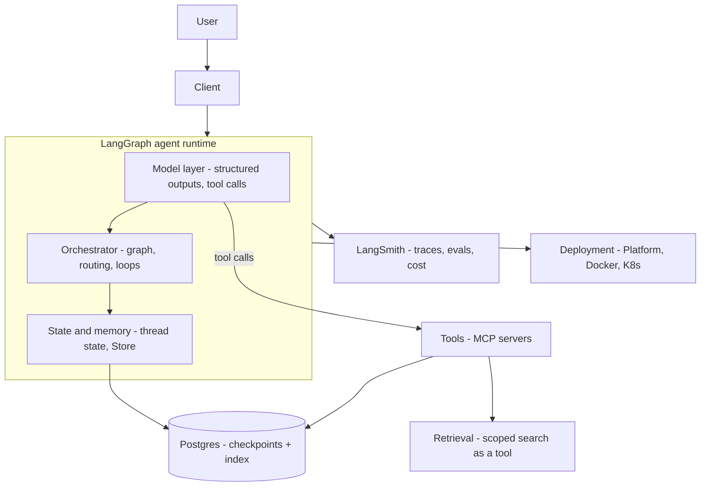

# Architecture

The one-page system view of a production agentic application. The nine modules teach the components one at a time; this page shows how they fit together before you start, and where each one is taught. Read it once now, then again after module 04 when the pieces start connecting.

The component framing follows the view popularized by Ayush Singh in [Agentic Engineering Roadmap For Beginners](https://www.youtube.com/watch?v=dt1eK_4rCAM) (published Oct 26, 2026): model components manage state and execute tool calls, an MCP server handles communication, a PostgreSQL database handles reliable data persistence, and the orchestrator keeps retrieval and tool execution scalable and secure, with state management consistent across environments. The map below is this repo's synthesis of that view, wired to the 2026 reference stack this curriculum teaches.

## The system at a glance

Every arrow on this diagram is a chapter and a runnable example. The components, in the order you will meet them:

## Model layer

The LLM plus the two capabilities that make it agentic: structured outputs (schema-constrained results) and tool calls (the model decides which tool to invoke with which arguments). Everything above this layer is plumbing; this layer is where correctness lives. Without structured outputs, downstream code parses prose; without tool calls, the model can only talk.

Taught in [05 Structured outputs and tools](01-foundations/05-structured-outputs-and-tools.md). Runnable proof: [structured_output_demo.py](examples/structured_output_demo.py).

## Orchestrator

LangGraph. The graph that decides what runs next: nodes, edges, conditional routing, parallel fan-out, loops with termination guards, and both API surfaces (StateGraph and Functional). The orchestrator is what turns a model into a system - it makes execution explicit, inspectable, and testable, and it is the piece that survives model swaps.

Taught in [02 LangGraph core](02-langgraph-core/) and the pattern catalog in [05 Agentic patterns](05-agentic-patterns/). Runnable proof: [langgraph_core_demo.py](examples/langgraph_core_demo.py).

## State and memory

Two different things that are often conflated. Thread state is the in-flight state of one run (messages, scratchpad, reducers merging parallel branches). Memory is cross-session state (user preferences, summaries, long-horizon context, via the Store). Keeping them separate is what lets you checkpoint the first and evolve the second.

Taught in [01 Graph state, edges, nodes](02-langgraph-core/01-graph-state-edges-nodes.md) and [02 Persistence and memory](03-agents-in-practice/02-persistence-and-memory.md). Runnable proof: [persistence_demo.py](examples/persistence_demo.py).

## Durable persistence

Postgres. The checkpointer writes state after every node; on crash or `interrupt()`, the run resumes from the last completed node. This is the reliable data persistence the video calls out, and it is also your answer to "what happens when the pod dies mid-run". The duplicate-side-effect problem (re-runs after partial failures) is solved with idempotent tools, not smarter graphs.

Taught in [04 Checkpointing and durability](08-production/04-checkpointing-and-durability.md). Runnable proof: [durability_demo.py](examples/durability_demo.py). The stack ships a `postgres:16` service in [docker-compose.yml](08-production/docker-compose.yml).

## Tools and MCP

The communication layer. Tools are how the model acts on the world; MCP is the standard that makes tools portable across frameworks and hosts. One MCP server can serve many agents; one agent can consume many servers. The boundary also carries the security story: the server owns credentials and scope, so the agent never does.

Taught in [04 Tools and MCP](04-tools-and-mcp/). Runnable proof: [mcp_client_demo.py](examples/mcp_client_demo.py) plus the three SDK servers next to it.

## Retrieval

Retrieval as a tool, not a pipeline stage: the agent decides when to search and reformulates when results are partial. Scoping and rate limits live inside the tool, so the corpus a prompt can leak is the corpus the tenant was allowed to see. In production the same tool ships through an MCP server, and the index lives in the same Postgres when the corpus allows it.

Taught in [06 Retrieval as a tool](04-tools-and-mcp/06-retrieval-as-a-tool.md). Runnable proof: [retrieval_demo.py](examples/retrieval_demo.py).

## Security and governance

Permissioned tools, audit logs, PII redaction, prompt-injection defense, and least privilege at every boundary: the tool boundary, the server boundary, and the deployment boundary. Security is a property of the architecture above, not a feature you add at the end - which is why each component section above names where its own boundary is enforced.

Taught in [06 Governance and safety](08-production/06-governance-and-safety.md) and [07 Safety and alignment](09-emerging-topics/07-safety-and-alignment.md). Runnable proof: [governance_demo.py](examples/governance_demo.py).

## Observability and evals

LangSmith traces, golden datasets, LLM-as-judge, cost and latency tracking, and the CI gate that blocks a PR when the eval regresses. The discipline that separates a system that works from a system you can prove works. Wire it in from module 01, not after launch.

Taught in [06 Evals and observability](06-evals-and-observability/). Runnable proof: [langsmith_demo.py](examples/langsmith_demo.py) and [run_evals.py](examples/run_evals.py).

## Deployment

LangGraph Platform for the managed path (`langgraph build` and deploy), Docker and Kubernetes for self-hosted, with HPA and the runbooks an on-call rotation needs. The deployment target changes the operational environment; the state-management contract above is what keeps behavior consistent across them - same checkpoints, same threads, same tools.

Taught in [01 LangGraph Platform](08-production/01-langgraph-platform.md), [02 Docker deployment](08-production/02-docker-deployment.md), and [03 Kubernetes](08-production/03-kubernetes.md). Runnable proof: [deploy_demo.py](examples/deploy_demo.py) and [k8s/](08-production/k8s/).

## Where to go next

- New here: start [01 Foundations](01-foundations/). The architecture above is your map; the modules are the territory.
- Want the linear version: [ROADMAP.md](ROADMAP.md) is the same system as a nine-phase path.
- Coming from another discipline: [learning-paths/](learning-paths/) routes you through the modules you actually need.
