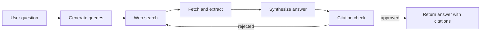

# Project 01 - Research agent

Difficulty: ⭐⭐
Estimated time: 1-2 weeks
Status: spec

## Problem

A user wants a researched answer to a question, with citations, in under 60 seconds, at under $0.05 per query. The research must be grounded in real web sources (no hallucinated citations), and the answer must be concise enough to read in one sitting.

This is the canonical "first real agent" project. It exercises every core skill: tool calling (web search and fetch), multi-step reasoning (search, read, decide whether to search again), structured output (the answer with citations), and evaluation (citation correctness). Build this first.

## Architecture

A LangGraph supervisor orchestrates three tools, exposed as MCP servers:

1. Web search (finds relevant pages for a query).
2. Fetch and extract (downloads a page and extracts the main text).
3. Citation checker (an LLM call that verifies every claim in the synthesis is grounded in a fetched source).

The agent loop: take the user's question, generate search queries, fetch the top results, synthesize an answer, run the citation checker, and return the answer with citations. If the citation checker rejects a claim, the agent re-searches and re-synthesizes.

## Stack

- Orchestration: LangGraph 0.2.x
- Tools: MCP servers (web search via Tavily or Brave; fetch via httpx + trafilatura)
- LLM: claude-sonnet-5-5 or gpt-5.5 (any current frontier tool-calling model)
- Observability: LangSmith
- Deployment: Docker

## Eval rubric

| Metric | Target | How measured |
|--------|--------|--------------|
| Citation correctness | 90%+ | LLM-as-judge: every claim grounded in a cited source |
| Answer relevance | 95%+ | LLM-as-judge: answer addresses the question |
| Latency p95 | under 60 seconds | Wall-clock from request to response |
| Cost per query | under $0.05 | Sum of LLM call costs |
| Hallucination rate | under 5% | Human spot-check of 50 queries |

## Datasets

- 30 research questions across domains (science, current events, how-to, comparison)
- Hand-labeled with key facts that should appear in the answer

## Stretch goals

- Multi-hop research (follow citations in fetched sources for deeper questions)
- Parallel research across sub-questions (decompose the question, research each in parallel)
- Persistent research memory (remember what the user has asked before)

## References

- [Perplexity's answer engine](https://blog.perplexity.ai/) - the canonical reference for this product
- [Tavily API](https://tavily.com/) - search API designed for LLM agents
- Real job postings: search "AI engineer" + "research agent" on builtin.com

## Solution

Reference solution: [-solutions/01-research-agent](https://github.com/AdilShamim8/Agentic-AI-Roadmap-with-Notes-and-Projects/tree/main/projects/-solutions/01-research-agent). Build your own first.
